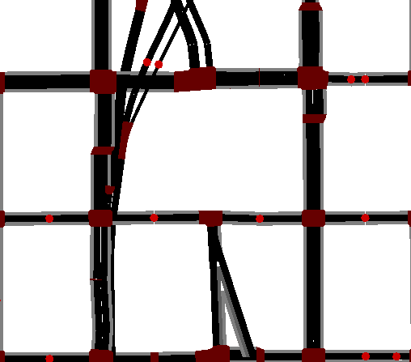
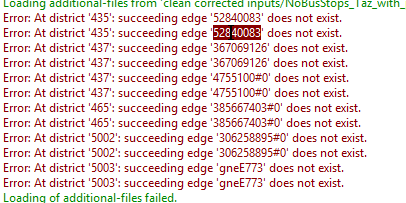
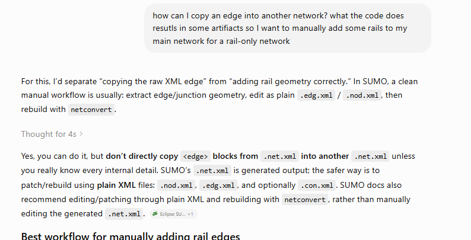
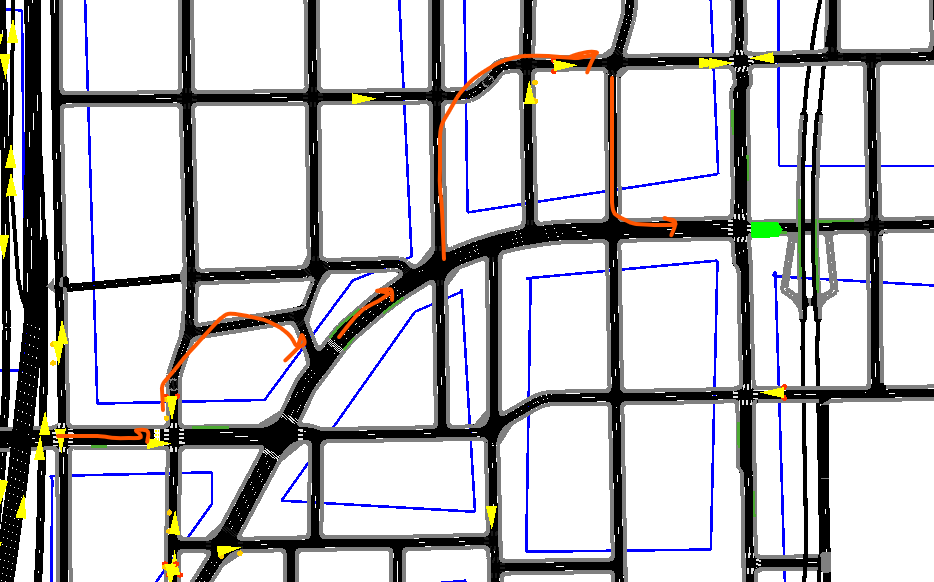

# read this before working on gtfs/DT simulation

### 1-this work was start by Zili Qu. 
She has a doc about the things she did. Read her stuff in `/Zili` first. 

### 2- in this directory, I regenerated her work. 
you can run `simulation.sumocfg` to run the modified verion or Zili's train or bus simulations. 
Here I fixed some network issues first (some rail tracks were not connected properly in `Zili\rail\toy network\seattle_lightrail_full.net.xml'` and in `merged.net.xml` that Zili made)
, then ran her codes to regenerate sumo files for bus and rail gtfs separately, and then combined them to make a simulation with both bus and rail.

### 3- debugging is needed
- Format:
    - `gtfs2pt` outputs are `add.xml` files and demand is not in `rou.xml` files. maybe it's better to have `rou.xml` file for demand. 
    - make sure that stop and trip names are what we expect based on GTFS files. This is particularly important regarding working with codes in `ridership`.
- Rail: 
    - we can do some preprocessing on gtfs data so that we only capture trips between Judkins park, UW, and SODO. the filtering that the code currently does is not effective. This one is also not very important but it would be nicer not to have a very big area for simulation. 

network: 
- run the `netconvert` command in the notebook one more time. you will recieve some network warnings. I suggest spending some time to find geometry issues of the network. By correct premissions in `soheil_seattle_correct_premissions` we mean that we allowed 'tram' for rail tracks and that was needed to make gtfs2pt work with no errors. 
- (**You may ignore the following network issues. soheil_seattle_merged.net.xml works well with older sim files. didn't remove them to keep track later.**)
  - The way Zili used SUMO commands to merge rail network (only the parts that were out of DT)
  and the older network file (the one in `/clean corrected inputs`) leads to some artifacts. For example, compare the old `.net.xml` file with the new one in this folder and see what happened to SR99 entrance.
  I think the best way to complement the rail network is simply by adding new edges from the rail network to the xml file of the old network directly,
  without using netedit or netconvert. 
  - I tried adding manually. not a good idea. coordinates mess up and gtfs2pt won't work properly. the reason behind Zili's 
  network problem is that her rail network has nodes like J0 and edges like E1. there are similar nodes/edges in the DT network. so I chnaged those names in the rail network and tried Zili's work again

<p align="center">
  
</p>





Bus:
- This is the main part that needs to be addressed. see below
- first of all: bus routes seems to be bad. they don't take most obvious routes! see screenshot below for a bus in line 8. 
could be a premission issue or speed issue. Probably the later because from old sim we know old network has some speed issues when sidewalks have low speeds compared to vehicle lanes.


- second: buses need to filtered and then added to the network. current filterning method is not very good (in notebook file)
Below is ChatGPT review of what we need to address for bus trips. I asked it to read ipynb file and the log when gtfs2pt is run for bus gtfs.

- In general, the proper workflow should include selecting specific routes, filtering them properly to be suitable for the incomplete network we have, and then run gtfs2pt on that. after that, we should carefully read the `gtfs2pt` log  and look at the simulation and how buses behave in simulation compared to our expectation. 

- Note that if you run Zili's bus simulation, you would face an error in simulation. that simulation is based on 12 routes that can be found in the ipynb file. Obviously this error should be fixed.

---------------------

# Review of `gtfs2pt.py` Log for KCM Bus Lines

The `gtfs2pt.py` command for the KCM bus GTFS appears to **run successfully**, but the output should **not be considered fully reliable yet**.

The script does not crash, and it does generate output files. However, the log shows several warning signs that the bus routes are not being mapped cleanly to the SUMO network.

## What Looks OK

The command successfully loads the SUMO network and the filtered GTFS file:

```text
Loading net
Loading GTFS data "gtfs data/kcm_google_transit_downtown.zip"
Success.
Writing fcd file "fcd\gtfs\bus.fcd.xml"
mapping bus
```

This means the basic inputs are readable:

- the SUMO network file is accepted;
- the filtered KCM GTFS zip is accepted;
- the selected bus GTFS data can be processed;
- the script is able to start generating bus-related SUMO output.

So, from a purely technical standpoint, the import process runs.

## Main Problems in the Log

### 1. Some GTFS points have no candidate SUMO edges

The log reports messages like:

```text
Found no candidate edges for ...
7 Points had no candidates.
```

This means some GTFS stop or trace points could not be matched to nearby usable SUMO road edges.

This is usually caused by one or more of the following:

- the stop is outside the SUMO network boundary;
- the stop is near the network edge but not close enough to a valid edge;
- the road exists geographically but is missing from the SUMO network;
- the edge exists but does not allow buses;
- the search radius is too small;
- the GTFS stop coordinate is closer to the wrong side of a divided road or one-way street.

This is a warning sign because if stops cannot be matched correctly, the generated public transport routes may become incomplete or distorted.

### 2. Some mapped routes have very large detour factors

The log reports large detour factors, for example:

```text
detour (factor 26.79)
detour (factor 17.55)
detour (factor 13.63)
```

These are not normal for a clean import.

A large detour factor means SUMO found a path between two mapped points, but that path is much longer than expected. For example, a detour factor of `26.79` means the mapped route segment is almost 27 times longer than the direct distance between the two points.

This usually means one or more of the following:

- stops are mapped to the wrong edges;
- stops are mapped to the wrong travel direction;
- the network is disconnected;
- bus access is not allowed on the expected road edges;
- the route is forced to take an unrealistic path;
- the filtered GTFS trip was chopped and no longer represents a realistic continuous route.

This is a serious quality issue. Even if SUMO generates a route, the route may not represent the actual bus movement.

### 3. Some bus routes are disconnected

The most serious warning is of this form:

```text
Warning! Disconnected route '800890320' between '456124866' and '460421475#1', no path found. Keeping longer part.
```

This means SUMO could not find a valid path between two consecutive mapped route segments.

When this happens, `gtfs2pt.py` keeps only the longer connected part of the route and discards the disconnected part.

That means some bus routes are likely being **silently shortened or chopped**.

This is especially important because the script may still finish successfully, but the generated bus routes may no longer match the intended GTFS service.

## Overall Diagnosis

The bus GTFS import is **technically successful but not clean**.

The output is useful for inspection and debugging, but I would not yet trust it for final simulation runs.

The main issues are:

- some GTFS points cannot be mapped to SUMO edges;
- some mapped route segments have unrealistic detours;
- some routes are disconnected;
- some generated bus routes may be incomplete;
- the filtered downtown-only GTFS may have created chopped trips.

The rail/tram import looked much cleaner. The KCM bus import has real mapping and network-connectivity issues that should be fixed before using the generated bus demand seriously.

## Suggestions: What to Do and What to Fix

- **Avoid clipping GTFS only by stops inside the bounding box without checking trip continuity.** This can create partial trips and disconnected route fragments.
- **Inspect the problematic stop IDs and edge IDs from the log** in NetEdit or with a simple map plot.
- **Verify bus permissions on the relevant SUMO edges.** Missing bus access can cause no-path and detour problems.
- **Check network connectivity near the problematic edges.** Some roads may be disconnected, one-way in the wrong direction, or missing turn connections.
- **Only adjust stop-matching radius after checking geometry.** A larger radius can help, but it can also map stops to wrong edges.
- **Consider importing fuller KCM trips first, then limiting demand or simulation area later**, instead of aggressively clipping the GTFS before running `gtfs2pt.py`.

---------------------

# Updates (October 2026)

## SUMO version: 1.28.0
`seattle_sumo_gtfsData_setup.ipynb` runs gtfs2pt from **SUMO 1.28.0** (released 2026-10-08). From 2026-10-05 to 2026-10-08 it used a nightly build (`v1_27_1+0902-aab68b732de`) for gtfs2pt fixes that were not in 1.27.1; all of them are in 1.28.0:
- #18237: duplicate busStop ids with `--use-gtfs-stopids`. 1.27.1 writes e.g. `gtfs_1610` twice and sumo fails with "probably declared twice"; 1.28 names the extra copy `gtfs_1610#1` (with a warning). This is why the old `dedupe_pt_stops` clean-up step was removed, so **the notebook needs 1.28.0 or newer**. (With the stop snapping the current lines no longer produce such duplicates, even on 1.27.1, but the fix is there if a new line does.)
- #18291: stale `resources/` cache reused after the network changes.
- #18238: trips with the same stops but different timing get their own route, so a line now has one route per timetable variant (e.g. 17 D Line routes for 5 stop patterns). Each vehicle's `line` is then `D_Line`, `D_Line#1`, ... instead of `D Line`. The ridership person flows (`lines="..."`) still use the plain name, so passengers only board the first variant. **Open issue** for the ridership simulation.

1.28 does not change how gtfs2pt places stops, so the stop snapping cell below is still needed. Checked on 2026-10-08: bus (C, D, E, G, H, 2, 4, 7, 8, 36) and rail outputs from 1.28.0 are identical to the nightly's. 1.28 also reads GTFS route type 109 as `train` now (#18292); our 1 and 2 Line are route type 0 (tram), so the rail import is unaffected.

Setup (Windows):
- Install SUMO 1.28.0 (or newer) with the Windows installer from https://sumo.dlr.de/docs/Downloads.php, and uninstall older versions so there is only one (the 1.28 installer goes to `C:\Program Files (x86)\SUMO`, not the old `...\Eclipse\Sumo` folder). The installer sets the machine-wide `SUMO_HOME`; both notebooks' Windows setup code reads it (fallback `C:\Program Files (x86)\SUMO`).
- `SUMO_VERSION` in the GTFS notebook's "FOR WINDOWS" cell: `"installed"` (default) or `"nightly"`, for trying a future nightly build: unzip https://sumo.dlr.de/daily/sumo-win64-git.zip and point `NIGHTLY_HOME` at the folder (falls back to the installed SUMO if it isn't there). Restart the kernel after switching. The cell prints the SUMO version it ended up with.
- The SUMO installer adds its `tools` folder to a machine-wide `PYTHONPATH`, which wins over `SUMO_HOME`, and uninstalling an old version may leave its entries in `PATH`/`PYTHONPATH`. The GTFS setup cell overrides `PYTHONPATH` and `PATH` for the kernel and for the `!python` gtfs2pt calls, so restart the kernel and run the setup cell first. To clean up the system itself: Start → "Edit the system environment variables" → Environment Variables, and remove entries for SUMO folders that no longer exist.
- gtfs2pt names its `resources/gtfs/` cache files after the network file's path. Pass the network as a short relative name (as the notebook does), otherwise Windows' 260-character path limit can be hit.
- Mac: the "FOR MAC" cell still points at the 1.27.1 framework; install 1.28.0 and change the version in its path (not tested yet).

## Line review order (ridership ranking)
The non-rapid lines are reviewed in order of ridership inside the simulated area. `bus/DT_buslines_ridership_ranking.csv` lists each line in `bus/DT_seattle_Buslines.txt` (downtown, Capitol Hill and edge groups) with `route_daily` (all boardings on the route per weekday), `area_daily` (boardings at stops inside the bus filter bbox, the sort key) and `area_AM` (same, 5–9 AM). Data: the latest period (`253` = 2025 Q3) of `../ridership/data/routeData/kcm/<route>/<period>/ridershipData.csv` (Git LFS; needs `git lfs pull`). Regenerate from `Simulation/` with `python ridership/rank_lines_by_ridership.py`. The bbox is a rectangle, not the network outline, so the numbers are approximate.

## Bus stop snapping (`snap_gtfs_stops_to_network`)
gtfs2pt puts each stop on whichever route edge is closest to the GTFS coordinate. That goes wrong at junctions (the cross street is closer, so the bus loops around to reach it), at the network boundary (a stop beyond the network snaps onto a `pseudo*` edge) and on opposite sides of the same street. The notebook cell right after the bus filtering cell fixes the filtered zip **before** gtfs2pt runs. For every stop:
1. The direction of travel comes from `shapes.txt`, at the stop's `shape_dist_traveled` (falls back to the nearest shape segment if that is missing). This matters for loops: the G Line passes Madison St & Terry Ave in both directions about 10 m apart.
2. Candidate edges allow buses, are within 35 m and head within 45 deg of the travel direction. `pseudo*` boundary edges and motorway mainlines don't count.
3. Candidate found: the stop coordinate is moved onto the nearest one, kept 7 m from the edge ends so it can't snap onto the neighbouring edge at the junction.
4. No real bus edge at all within 35 m: the stop is outside the network and is removed from the timetable, so the trip ends at the previous stop (trips left with fewer than 2 stops are removed).
5. Only cross streets nearby (no road of any kind heading in the travel direction): the street the bus runs on is not in the network, so the stop is removed the same way (printed as `dropped ... (street not in the network, only cross streets nearby)`). Example: route 36's 12th Ave S stops, which otherwise land on S Weller St / S Jackson St.
6. A road in the travel direction exists but no bus edge does: the stop is left unchanged and printed as a WARNING. This usually means a network direction or permission problem worth fixing rather than hiding.
7. Stops pinned in `bus/patched_stops.add.xml` are left to the pin (commented-out pins don't count). The file currently has no active pins (stop 1559 is handled by snapping) but must stay, since gtfs2pt is called with `--patched-stops`.

The cell rewrites `gtfs data/kcm_google_transit_downtown.zip` in place, so always run the filtering cell before it. Run order: setup cell, bus filtering, snapping, bus gtfs2pt. Delete `resources/` and `fcd/` after any network change.

## Network patches (`additional_net/`)
The source map predates some street changes and stops at W Republican St, so several bus lines were routed around missing streets. All hand-made network patches are kept in `additional_net/` and have been applied to `soheil_seattle_merged.net.xml`; `soheil_seattle_merged_pedspeed.net.xml` was then regenerated with the ped-speed cell in `seattle_sumo_network_setup.ipynb` (which also writes `additional_net/ped_speed_patch.edg.xml`).

| Patch | Files | What it adds |
|---|---|---|
| Columbia St eastbound bus lane | `columbia_eb_bus.edg.xml`, `.con.xml`, `.tll.xml` | Bus-only eastbound lane on Columbia St from Alaskan Way to 3rd Ave (edges `-635483971` ... `-370819917#1`; the 2019 change is missing from the map), with the south sidewalk moved from the westbound edges onto it. Fixes the northbound C Line looping around the block. The signal programs at Alaskan Way, 1st, 2nd and 3rd Ave are the originals plus one link per new bus movement. |
| Mercer St, Elliott Ave W to Warren Ave N | `mercer_st.nod.xml`, `.edg.xml`, `.con.xml`, `mercer_st_pass2.con.xml` | From current OSM geometry: W Mercer Pl, with the ramp off southeast-bound Elliott and the link back onto northwest-bound Elliott (priority junction, Elliott keeps priority), and W Mercer St / Mercer St (1 lane each way west of 2nd Ave W, 2 each way east of it, sidewalks, 25 mph). Connects 4th/3rd/2nd/1st Ave W, Queen Anne Ave N (southbound) and 1st Ave N (northbound, extended 30 m). Default signals at 3rd Ave W, 2nd Ave W, 1st Ave W, Queen Anne Ave N, 1st Ave N and Warren Ave N. Fixes the D Line's misplaced stops and U-turn. Elliott, 1st Ave W and Warren Ave N are split where they meet it; the Elliott pieces at the network boundary keep their original ids (`22759220#9`, `-22759220#9`) because they are TAZ sources/sinks. |
| Small connection repairs | `network_fixes.con.xml` | 3rd Ave northbound from Wall St to Vine St (`370785080#0`) had no outgoing connections at Vine St, so the northbound D Line detoured via Wall St and Vine St. E John St westbound at 10th Ave E (`-337668916#0` → `-6463013`): only the sidewalk continued straight, so westbound route 8 turned off and looped back. |
| E Union St westbound bus block | `e_union_st_wb_bus.edg.xml`, `.con.xml` | The one-way, bus-only block of E Union St from 12th Ave / E Madison St to 11th Ave (OSM way 337673341, edge `337673341`: lane 0 sidewalk, lane 1 bus). The network stopped at Madison, so westbound route 2 detoured via Madison, Seneca St and 10th Ave. No signals involved. |
| Belmont Ave E / Bellevue Pl E | `belmont_bellevue_pl.nod.xml`, `.edg.xml`, `.con.xml` | The two short streets joining the north end of Summit Ave E to the north end of Bellevue Ave E: Belmont Ave E (OSM way 621088606, edges `±621088606`) and Bellevue Pl E (way 51476458, edges `±51476458`), two-way, 1 lane each way + sidewalk, 25 mph, all-way stop where they meet (node `53118280`). Both street ends were dead ends, so the northbound route 3 made a U-turn at the top of Summit, came back via Mercer St and made another U-turn on Bellevue Ave E. The dead-end U-turns are deleted; Summit and Bellevue Ave E edges keep their ids (they are TAZ sources/sinks). First patch built with SUMO 1.28 netconvert (no other changes to the network). |

Related: `clean corrected inputs/correct_Alaskan_new_signal_additional_columbia_eb.add.xml` is a copy of the signal additional with the Columbia St programs extended to match. `gtfs_ridership_vehicular.sumocfg` and `gtfs_transit_only.sumocfg` use it; the original is still used by the configs on the older network.

**If `soheil_seattle_merged.net.xml` is ever regenerated, reapply the patches in this order** (run from this folder), then rerun the ped-speed cell. Mercer St needs two passes: the second removes a connection that only exists after Elliott is split. Existing edges keep their stored connections when edges are added next to them, so turns from former dead ends are listed explicitly in the `.con.xml` files.
```
netconvert -s soheil_seattle_merged.net.xml -e additional_net/columbia_eb_bus.edg.xml -x additional_net/columbia_eb_bus.con.xml -i additional_net/columbia_eb_bus.tll.xml --no-turnarounds -o soheil_seattle_merged.net.xml
netconvert -s soheil_seattle_merged.net.xml -n additional_net/mercer_st.nod.xml -e additional_net/mercer_st.edg.xml -x additional_net/mercer_st.con.xml --no-turnarounds -o soheil_seattle_merged.net.xml
netconvert -s soheil_seattle_merged.net.xml -x additional_net/mercer_st_pass2.con.xml --no-turnarounds -o soheil_seattle_merged.net.xml
netconvert -s soheil_seattle_merged.net.xml -x additional_net/network_fixes.con.xml --no-turnarounds -o soheil_seattle_merged.net.xml
netconvert -s soheil_seattle_merged.net.xml -e additional_net/e_union_st_wb_bus.edg.xml -x additional_net/e_union_st_wb_bus.con.xml --no-turnarounds -o soheil_seattle_merged.net.xml
netconvert -s soheil_seattle_merged.net.xml -n additional_net/belmont_bellevue_pl.nod.xml -e additional_net/belmont_bellevue_pl.edg.xml -x additional_net/belmont_bellevue_pl.con.xml --no-turnarounds -o soheil_seattle_merged.net.xml
```

**Applied 2026-10-23 (in both networks and the signal file; lab before/after pending):** 3rd Ave & Yesler Way (tls 53071891): `additional_net/third_yesler.con.xml` removes the 3rd Ave SB right turn onto Yesler WB (lane 1 through only), `third_yesler.edg.xml` sets `6449188#0` to spreadType right so its lanes line up with `gneE173` (were offset 6.4 m; re-centring gneE173 instead moved bus stop 1610 onto the Yesler WB lane and sent 9 lines through Yesler), and `third_yesler_signal.diff` replaces the 154.5 s program (3rd SB green 12%, Yesler 61%) with a 90 s one (3rd through 46 s, 3rd SB left 12 s, Yesler 18.5 s). Apply both together: `netconvert -s soheil_seattle_merged.net.xml -e additional_net/third_yesler.edg.xml -x additional_net/third_yesler.con.xml --no-turnarounds -o soheil_seattle_merged.net.xml`, rerun the ped-speed cell, then the patch command in the diff header. GTFS outputs and riders regenerated 2026-10-23 (see pedestrian-only paths below).

**Applied 2026-10-23 (working copy): pedestrian-only paths** `additional_net/ped_only_paths.edg.xml` + `.con.xml`: `gneE170` (footpath from 3rd Ave at tls 764028198 to Yesler; its vehicle lane removed) and `gneE743` (plaza at tls 53088992). Reapply after the Yesler patch: `netconvert -s soheil_seattle_merged.net.xml -e additional_net/ped_only_paths.edg.xml -x additional_net/ped_only_paths.con.xml --no-turnarounds -o soheil_seattle_merged.net.xml`, then the ped-speed cell. tls 764028198 in the signal file now has 5 links (was 7). Bus lines 101/102/150 (131 trips) used gneE743; their shortest bus path is now 61025856#0 -> 61025856#0.46 -> 332223495 -> 164241876. Regenerated 2026-10-23: only 101/102/150 changed (they now stay on the main road through tls 53088992: 400679671 -> gneE458; stop gtfs_390 moved from 164241876 to gneE458); 4466 buses, 230 stops, 531 trains, rider counts unchanged. Headless cell runs need anaconda first on PATH, or `!python` gtfs2pt fails with "No module named 'rtree'".

**Drafts (not applied):**

`additional_net/drafts/signal_3rd_james_90s.diff` lengthens phase 0 of signals `764028198` and `53221905` so both run 90 s cycles at 3rd Ave & James St (tested on a copy 2026-10-21: teleports 101 -> 71). It edits a copy of the signal file, not the network; the apply command is in the file's header.

## Reviewed bus lines and through-routed lines
All numbered downtown KCM lines were reviewed one by one (October 2026) and run together with
`KEEP_ROUTES = ["4","7","8","36","2","40","70","62","14","1","5","49","13","11","3","150","10","12","124","21","101","132","28","131","27","24","33","125","102","322","256","17","57","56","113"]`
(0 snapping warnings, 3458 vehicles). Route 121 has no trips in the feed; 105 has no stops in the area. The rapid lines C, D, E, G, H were reviewed separately; add them to the list for a full simulation.

Things that look like errors but match GTFS:
- **Through-routed lines.** KCM publishes one bus run as two lines that hand over at a downtown stop: the bus ends one trip and starts the next (other line number) at the same stop and minute (same `block_id`). Inside the network this shows up as one direction of a line ending early, or missing entirely when its only in-area stop is the hand-over stop (the trip is then removed by snapping, `< 2 stops`). Review/run the partners together. Weekday hand-overs among the lines above (trips per day, 05:00-12:00 in brackets):

  | From | To | At | Trips |
  |---|---|---|---|
  | 5 (to downtown) | 21 (Westwood Village) | Wall St & 5th Ave | 68 (25) |
  | 21 (to downtown) | 5 (Shoreline/Greenwood) | 4th Ave S & S Royal Brougham Way | 67 (26) |
  | 14 (to downtown) | 1 (Kinnear) | S Jackson St & 12th Ave S | 63 (25) |
  | 1 (to downtown) | 14 (Mount Baker) | 3rd Ave & Cedar St | 64 (24) |
  | 28 (to downtown) | 132 / 131 (Burien) | Wall St & 5th Ave | 37 (14) / 6 (6) |
  | 131 / 132 (to downtown) | 28 (Carkeek Park) | 4th Ave S & S Royal Brougham Way | 36 (14) / 6 (0) |
  | 24 / 33 (to downtown) | 124 (Tukwila) | 3rd Ave & Cedar St | 34 (13) / 27 (13) |
  | 124 (to downtown) | 24 / 33 (Magnolia) | 4th Ave S & S Royal Brougham Way | 34 (14) / 27 (11) |
  | 2 (to downtown) | 13 (SPU) | Seneca St & 8th Ave | 34 (10) |
  | 13 (to downtown) | 2 (Madrona) | 3rd Ave & Cedar St | 31 (12) |
  | 33 (to downtown) | 27 (Colman Park) | 3rd Ave & Cedar St | 1 (1) |

  So the groups are 1+14, 5+21, 2+13, 24+33+124, 28+131+132 (+27).
- **Peak-direction commuter lines** (101, 102, 113, 150, 322, ...) run into downtown in the morning and out in the afternoon, so one direction is missing in a 05:00-12:00 run. Their afternoon stops (e.g. route 113 on 2nd Ave) still appear in the simulation because stops are loaded for all generated trips.
- **Schedule changes since the feed:** live maps can differ, e.g. route 62 now ends at S Washington St & 3rd Ave S instead of 5th Ave S. The lines were reviewed with the summer 2026 feed (SPR26). The bus pipeline now uses the fall 2025 feed (FAL25, see "Bus schedule and ridership" below), which is the same as SPR26 inside the network apart from trip counts and one E Line stop.
- Route 125 has one late-evening trip that loops the block at 3rd Ave & Pike St (gtfs2pt "detour" warning); that is its real turnaround.

## Bus riders (ridership)
Riders for all 40 lines come from `../ridership/ridership_personflows.py`; see the "Current method" section of `../ridership/readme.md`. For this the bus gtfs2pt cell uses `--original-lines`, so every bus of a route has the plain route name as `line` (`8`, `C_Line`). `KEEP_ROUTES` now lists the rapid lines and the 35 numbered lines. Both GTFS configs run single-threaded (`threads 1`, `device.rerouting.threads 0`), because with riders SUMO 1.28 crashed, hung or corrupted its output when multithreaded.

## Bus schedule and ridership: same service period (October 2026)
**Best practice: only update the bus schedule (GTFS) when ridership for the same service period is available, and only update the ridership when a matching schedule is available. Change them together.** The riders are generated per stop, direction and time of day from the ridership data and tied to the buses of the schedule. A schedule from another period has different trips, stops and terminals, so riders get lost or mismatched.

| | File / setting | Period |
|---|---|---|
| Bus schedule (current) | `gtfs data/kcm_google_transit_FAL25.zip` (KCM feed FAL25-159.1), sim date **2025-10-15** (Wednesday) | 2025-09-08 to 2026-03-27 |
| Bus ridership (current) | `../ridership/data/routeData/kcm/<route>/253/` | 253 = Aug 30, 2025 - Mar 27, 2026 |
| Bus schedule (previous) | `gtfs data/kcm_google_transit_SPR26.zip` (feed SPR26-160.5), sim date 2026-06-17 | 2026-06-08 to 2026-08-28 |

- **Where FAL25 comes from:** KCM's own feed as saved by the Internet Archive on 2025-10-07: `https://web.archive.org/web/20251007123721id_/http://metro.kingcounty.gov/GTFS/google_transit.zip`. Transitland has all past KCM versions, but downloading them needs a paid API plan.
- **Ridership:** from the seattleTransitRidership repo, which uses KCM stop-level data shared by Seattle Transit Blog. Period 253 is its newest stop-level period (checked 2026-10-22); newer periods would have to be requested from KCM. Period dates are in that repo's `backend/app/config.py`.
- **Test before switching** (transit-only with riders, 05:00-12:00, on a copy; details in `../Work_Done.txt`, October 22nd):

  | | SPR26 schedule | FAL25 schedule |
  |---|---|---|
  | Buses in the day's file | 4,518 | 4,466 |
  | Stops | 230 | 230 (the same stops) |
  | Boardings vs ridership | 0.973 | 0.973 |
  | Lines with >100 boardings within ±10% | 28 of 33 | 31 of 33 |
  | Rider wait, median | 4.4 min | 4.4 min |
- **To switch a feed:** edit `../scenario.json` (below), rerun the notebook, then `../ridership/ridership_personflows.py`, and recommit the reference set (below).

### Scenario file (`Simulation/scenario.json`)
The scenario is set in one file. Since 2026-10-22 it is read by the notebook's filter and bus gtfs2pt cells, `../ridership/ridership_personflows.py`, `check_bus_routes_vs_shapes.py` and `../ridership/rank_lines_by_ridership.py`, through `../scenario.py`. Before that, the same settings lived in four places.

| Key | Meaning | Now |
|---|---|---|
| `name` | label | `FAL25_253` |
| `bus_feed` | full KCM GTFS zip, relative to `scenario.json` | `GTFS/gtfs data/kcm_google_transit_FAL25.zip` |
| `sim_date` | simulated day, `YYYY-MM-DD`; gtfs2pt `--date` and the weekday are derived from it | `2025-10-15` |
| `ridership_period` | ridership service change (folder under `ridership/data/routeData/kcm/<route>/`) | `253` |
| `ridership_period_dates` | optional `[first, last]` day of the period, for a warning check | `2025-08-30` to `2026-03-27` |
| `keep_routes` | bus lines (GTFS `route_short_name`) | the 40 lines |

- The rider files are named after the period: `kcm_riders_<period>_AM_MID.rou.xml` (+ `_summary.csv`, `_skipped.csv`). If you change the period, point `gtfs_ridership_vehicular.sumocfg` at the new file name. That's the one setting not taken from the scenario.
- **Another scenario without editing the file:** set the environment variable `SUMO_SCENARIO` to another JSON file, e.g. for tests or the multi-period runs. Its paths are relative to that file.
- **Warnings:**

  | Where | Warns about |
  |---|---|
  | `scenario.py` | a feed file that doesn't exist; a weekend sim date (the ridership is weekday ridership); a sim date outside `ridership_period_dates`; duplicate lines |
  | filter cell | lines missing from the feed (left out); lines with no trip on the sim date; a feed with no service on that day |
  | rider script | a coverage table: which bus lines have ridership for the period, and how many buses run without riders; scenario lines with no buses |

  Lines without ridership are now logged once per line in `_skipped.csv`, with their bus count. Before, every bus of the line got a misleading "no matching ridership direction" row.
- **Python:** the notebook adds `Simulation/` to `sys.path` to import `scenario.py`. The scripts do it themselves.
- **Rail section (`"rail"`, since 2026-10-22):** read by the notebook's rail filter and rail gtfs2pt cells and by `../ridership/rail_personflows.py`. Rail may use a different period from the buses, but its schedule and ridership should match each other.

  | Key | Meaning | Now |
  |---|---|---|
  | `feed` | Sound Transit GTFS zip | `GTFS/gtfs data/rail_gtfs.zip` (SC-Spring-2026.9, 2026-04-14 to 2026-08-28) |
  | `sim_date` | rail simulated day; rail gtfs2pt `--date` | `2026-04-22` (Wednesday; it used to be Sunday 2026-03-29) |
  | `lines` | Link lines | `1 Line`, `2 Line` |
  | `ridership_file` | average weekday boardings per station | `ridership/data/link/link_station_boardings_2026-04_2026-05.csv` |
  | `ridership_label`, `ridership_dates` | label for file names; months the boardings cover | `2026-04_05`; 2026-04-01 to 2026-05-31 |
  | `downtown_stations` | stations in the study area | Capitol Hill, Westlake, Symphony, Pioneer Square, Int'l Dist/Chinatown, Stadium, SODO |
  | `time_of_day_share` | share of daily boardings in AM / MID (**assumption**, see below) | 0.190 / 0.348 |
- **gtfs2pt Python:** gtfs2pt needs a Python with `rtree`, e.g. Anaconda. Make sure the `python` on PATH, which the notebook's `!python` uses, is that one.

## Link riders (`../ridership/rail_personflows.py`, October 2026)
Riders for the 1 and 2 Line, generated for every trip that starts or ends at a downtown station. Run from `Simulation/ridership/` with `python rail_personflows.py`, after the rail gtfs2pt and Link vType cells. The output is `link_riders_<label>_AM_MID.rou.xml`, plus `_summary.csv` and `_skipped.csv`. `gtfs_ridership_vehicular.sumocfg` loads it; the transit-only config has no riders.
- **Data:** Sound Transit's system performance tracker (Power BI dashboard on soundtransit.org, Ridership → Link). Settings used: plot axis Station, Avg Boardings per Day, Day Type Weekday, April + May 2026. The 38 station values were read on 2026-10-22 into the CSV.
  - The values are station totals, both lines combined.
  - Sound Transit publishes **boardings only**: no alightings, no direction, no time of day, no origin-destination pairs. There's no download; the numbers have to be read from the dashboard.
  - **Faster than reading by hand (found 2026-10-22):** the public dashboard can be queried directly. In the browser's dev tools on the embedded report, watch for a POST to `https://wabi-west-us-c-primary-api.analysis.windows.net/public/reports/querydata` (header `X-PowerBI-ResourceKey: 2f5a6cce-53bc-491a-ac36-6e63236af4ec`, dataset `2cbf69f2-7934-4f12-be1c-04b168bf861b`). Copy one captured request body and change the query to: entity "Link ridership data", select `StationName` and the measure `AvgBoardings`, filter `Date.MonthName` in the wanted months and `ScheduleMap = 'Weekday'`. This reproduced `data/link/link_station_boardings_2026-04_2026-05.csv` exactly. The key and IDs are the dashboard's public embed values and may change when Sound Transit republishes it. No script yet; worth writing one if periods are updated often.
  - Marymoor Village has boardings but isn't in the model's rail network.
- **Method:**
  - **Alightings = boardings at every station** over the day.
  - **Destinations by gravity:** riders boarding at station o go to every station a train of the day reaches after o, in proportion to that station's alightings. Trips per weekday o → d = B_o × A_d / Σ A over the stations reachable from o.
  - **Time of day:** the KCM bus shares (AM 05-09: 19.0% of daily boardings, MID 09-15: 34.8%), spread evenly within each period.
  - **Riders:** personFlows with random arrivals, waiting on the origin platform for any train of a line serving both stations, only while such trains run. Train lines are plain names (`1_Line`, `2_Line`), because the rail gtfs2pt cell now uses `--original-lines`.
- **Result (rail date 2026-04-22, 531 trains, 836 flows):** about 36,500 Link riders expected 05:00-12:00. That's 14,500 from downtown, 15,100 to downtown and 7,000 within downtown.
  - Test run 05:00-08:00 with bus + Link riders, transit only: 12,495 Link rides finished by 08:00, out of 14,363 riders who had started by then; the rest were still riding at 08:00. Wait median 3.2 min, mean 5.4 min.
- **To revisit (needs official data):**
  1. **Alightings.** Alightings = boardings ignores the commute direction: more riders arrive downtown in the morning and leave in the afternoon. Replace with Sound Transit alighting / origin-destination data, or ORCA-based data, when available.
  2. **Time of day.** The profile is borrowed from KCM buses.
  3. **Through riders.** Trips between two stations outside downtown that pass through it (e.g. U District → SeaTac) are not generated, so trains through downtown carry fewer riders than in reality.
  4. **June.** June 2026 (World Cup) was left out of the boardings on purpose.

## Crash fix: `device.rerouting.pre-period 0` (October 2026)
Both GTFS configs set `<device.rerouting.pre-period value="0"/>` in `<routing>`. **Don't remove it:** without it, every run with the car demand crashes (segmentation fault, no SUMO error message) between about 07:13 and 08:11 simulated time, at the same step every time.
- Cause (a SUMO bug, present in 1.27.1 and 1.28.0): the car demand has TAZ trips with only `fromTaz` (no `from` edge). A car that waits to be inserted is rerouted every 60 s by default (`pre-period`). With `device.rerouting.with-taz` the new route can start on a different source edge of the TAZ, but SUMO still inserts the car on the old edge, so it sits on an edge that isn't in its route. Two such cars together crash SUMO.
- `pre-period 0` turns off rerouting before insertion. Rerouting while driving (probability 0.7, every 300 s) is unchanged.
- Validated on the lab server on 2026-10-20 with two full 05:00-12:00 runs: the full config (cars + buses + trains + riders) and cars + transit without riders. Both finished with exit code 0. Car results up to 07:23 are nearly unchanged (mean trip 311.4 s vs 312.4 s). Bus boardings were 0.97 x ridership with cars (0.99 transit-only), median rider wait 4.9 min. Details in `../Work_Done.txt` (October 19th-20th and October 20th).
- Reported to the SUMO developers on 2026-10-22: eclipse-sumo/sumo#18408 (network, TAZs and demand offered on request).

## Route check vs GTFS shapes (`check_bus_routes_vs_shapes.py`)
This checks every generated bus route against the path-accurate GTFS shape of its trips, and the per-line trip counts. It's analysis only and changes nothing. Run it from this folder with `python check_bus_routes_vs_shapes.py`. It needs pandas, numpy, shapely ≥ 2.0 and pyproj; SUMO's sumolib comes from `SUMO_HOME/tools`. Anaconda on the home PC lacks shapely and pyproj; a separate venv works (used 2026-10: Python 3.14, numpy 2.5, shapely 2.2, pyproj 3.8): `C:\Users\dahh2\anaconda3\python.exe -m venv <folder>`, then `<folder>\Scripts\python.exe -m pip install pandas numpy shapely pyproj`, and run the script with that python. It takes about 5-20 s. Outputs go to `route_check/` (generated, not committed): `route_check_trips.csv`, `route_check_lines.csv`, `route_check_flagged_patterns.csv`, `route_check_summary.md` and `flagged_geojson/` (shape vs route per flagged pattern; open them in QGIS or geojson.io).
- **Method.** The route (bus-lane shapes of its edges) and the shape are both clipped to the first and last served stop and sampled every 5 m. A sample more than 25 m from the other line is "off". A trip is **flagged** when the longest continuous off stretch is longer than 100 m, or when more than 5% of the route is off. Each flag gets a cause label:
  - geometry offset: never more than 50 m off, so the same street drawn differently
  - terminus
  - missing street: no bus edge along the shape
  - snapping: near a moved stop that now lies off the shape
  - otherwise, shortest path instead of shape

  The network has no street names (netconvert ran without `--output.street-names`), so off stretches are named after nearby KCM stops.
- **Metrics from Kaiser & Schmaus 2026** (SUMO User Conference, gtfs2pt route reconstruction; PDF in `Seattle_Sumo/Relevent_Papers/`): trips planned vs generated per line (their Table 1), RNS/RIS stop-sequence ratios, and "route matches the shape" as our version of their ISE. Our feed has shapes, so the shape is the reference. They had to compare two methods with each other instead.
- **Results (05:00-12:00):** first run 2026-10-21 on the SPR26 schedule; rerun 2026-10-22 on FAL25 (2025-10-15) with the same flags and the same 108 wrong-street trips. FAL25: 1,739 trips checked, 1,809 planned, 70 missing (40 with fewer than 2 network stops, 30 at the edge of the time window), match ratio 0.938 without artifacts. The numbers below are the SPR26 run.
  - 1,763 trips checked, 232 flagged.
  - 124 of the flagged trips are a geometry offset on Alaskan Way near Columbia St: C Line both directions and H Line southbound, 20-38 m off for about 150 m. That's the rebuilt waterfront street vs the network geometry, not a different street.
  - **108 trips (6.1%) take a different street than the real route.** All are gtfs2pt's shortest path between two stops with no stop in between. None is caused by the snapping or by a missing street.
    - southbound **21**: 1st Ave S instead of 4th Ave S / Edgar Martinez Dr S (25 trips, 1,280 m)
    - northbound **H Line, 21, 56, 57, 113** after Alaskan Way & Columbia St: Alaskan Way → Marion St → 3rd Ave instead of the Columbia St bus lane → 3rd Ave (59 trips, 440 m, one block over). These trips don't stop at 3rd Ave & Marion St, so nothing holds them to Columbia St; the C Line and 125 stop there and stay on Columbia St. Whether Marion St is really open eastbound from Alaskan Way is **[UNVERIFIED]**.
    - southbound **125**: 4th Ave / Pike St instead of 3rd Ave / Virginia St / Pine St (15 trips, 265 m)
    - **3** toward Madrona: Union St / 4th Ave / 5th Ave instead of 3rd Ave / Pike St / Pine St (9 trips, 395 m)
  - Match ratio 0.939 without the artifacts (0.868 raw).
  - **Trip counts:** 1,831 planned vs 1,763 generated. All 68 missing trips are expected:
    - 40 through-routed trips with fewer than 2 stops in the network (route 14: 26, route 131: 14)
    - 28 where a stop inside the bbox falls in the window but the first network stop doesn't
  - **Stop sequences:** RIS = 1 for every trip. gtfs2pt kept every snapped stop, in order.
- **The paper's route method vs our stop snapping.** They fix different things.
  - **Our snapping** decides *where each stop is*: the edge heading the way the bus travels, or dropped if it's off the network. gtfs2pt then joins the stops by the shortest path. The check shows the snapping does its part: no flag comes from it, no stop was lost or reordered, and every missing trip has an expected cause.
  - **The paper** decides *how the bus gets from stop to stop*, and also which stop of a station to use:
    - streets no bus uses in OSM get a 3600 s weight, and U-turns +3600 s
    - the line's OSM route relation is passed as via points
    - a Dijkstra over all candidate stops picks the shortest whole trip
    - a leg that passes another station of the trip without stopping is rejected

    That targets exactly the 108 remaining wrong-street trips.
  - **Downsides for us:**
    1. It needs OSM bus data (which streets buses use, route relations) mapped onto our network. Our network is an older, hand-edited OSM import with split and `gneE*` edges and no street names, so that is the same mapping problem that stopped us using gtfs2pt `--stops` (#18341).
    2. It doesn't use GTFS shapes, because Magdeburg's feed has none. Ours has path-accurate shapes, which are a better reference than OSM relations; the paper itself found OSM missing a current diversion.
    3. The stop clustering by name isn't needed here: `--use-gtfs-stopids` already gives one stop per GTFS stop.
    4. It replaces gtfs2pt's routing with its own pipeline: duarouter per stop pair plus a SciPy Dijkstra. Its results were only spot-checked against reality.
    5. "Shortest whole trip" can still pick the wrong street where buses use both streets (4th vs 3rd Ave for route 125 and 3) unless the OSM via points are right.
  - **Worth taking from it:**
    - the validation metrics (done here)
    - the rule that a leg must not pass another stop of the same trip without stopping
    - possibly the U-turn penalty
  - **Simplest fix for our 4 places:** a step after gtfs2pt that re-routes each stop-to-stop leg along the GTFS shape, either by map-matching the shape onto bus edges or by passing via edges taken from the shape. Rerun this check afterwards; the target is 0 real deviations. Not done yet.

## Bus routes along the GTFS shapes (`route_buses_by_shape.py`, October 2026)
Notebook cell `5b1e7c2a` runs it after the bus gtfs2pt cell and before the vType cells (from this folder: `python route_buses_by_shape.py`). gtfs2pt joins consecutive stops by the shortest path, so where a bus passes no stop between two parallel streets it took the wrong one (route check: 108 trips in 4 places, see above). The script keeps every stop and re-routes only stop-to-stop legs that leave the trip's GTFS shape.
- **Method:** per route, the shape of its trips (from `gtfs data/kcm_google_transit_downtown.zip`) is projected onto the network. Each leg (route start, stop edges in order, route end) is re-routed by a Dijkstra over bus-permitted connections. An edge whose bus lane is on average more than 20 m from the shape costs 21x its length. A leg is replaced only if it gets at least 150 m less off-shape length (MIN_GAIN; 30 m in f6be9ca also changed lines 7, G, 10, 11, 12 by 70-109 m, which the lab run S1 linked to more teleports and skipped stops; the real fixes gain 243-1,075 m). Connectivity is checked before writing; only the `edges` of `<route>` elements in `bus/gtfs_pt_vehicles.add.xml` change.
- **Dependencies:** standard library + sumolib. It has its own UTM projection (identical to pyproj to the mm), so it runs in anaconda without pyproj.
- **Result (2026-10-25, FAL25, MIN_GAIN 150 m):** 50 of 811 routes changed: lines 21, H, 56, 57, 113, 125, 3 (the 108 flagged trips) and 49 (shares line 3's leg). Route check: real deviations 108 -> 0, match ratio without artifacts 0.938 -> 1.000. The remaining 198 flags are the known Alaskan Way geometry offset (35-38 m), now including the H/21/56/57/113 northbound and 125 trips that follow their shapes along it. Off-shape length per changed route dropped on every line (e.g. 21: 976 -> 70 m, 125: 301 -> 93 m); route 125 is 620 m longer (its loop on Virginia/Pine).
- **Transit-only check 05:00-12:00:** same 4 bus teleports, 19,879 stops served in both, changed lines' mean trip 784 -> 782 s, no new warnings. Rerunning the notebook chain reproduces the file exactly.

## Bus and train types, stop lengths (vType cells, October 2026)
gtfs2pt always writes `type="bus"` / `type="tram"`, the mode name, and makes every bus stop 13 m and every tram stop 60 m long. Two cells after the gtfs2pt cells replace that. Run them after gtfs2pt, Link cell first:
- **Link vType cell:**
  - writes `rail/tram.add.xml`
  - defines `assign_vtypes()` and `lengthen_stops()`
  - sets each train's type from `vtype_by_line.csv`
  - makes train stops 120 m (Link platforms are 380-400 ft)
- **Bus vType cell:**
  - writes `bus/bus.add.xml`
  - sets each bus's type from `vtype_by_line.csv`
  - sets bus stop lengths

`bus/bus.add.xml` and `rail/tram.add.xml` are now generated by these cells. Edit the cells, not the files.

| vType | Length | personCapacity | sumo-gui color | Lines (from the table) |
|---|---|---|---|---|
| `rapidride60` | 18.3 m | 115 | orange | C, D, E, G, H |
| `trolley60` | 18.3 m | 115 | blue | 7, part of 36 |
| `trolley40` | 12.2 m | 80 | blue | 1, 2, 3, 4, 10, 13, 14, 49, part of 36 |
| `bus60` | 18.3 m | 115 | green | 5, 8, 17, 21, 24, 27, 28, 33, 40, 57, 62, 70, 101, 102, 113, 124, 131, 132, 150, part of 256 |
| `bus40` | 12.2 m | 80 | purple | 11, 12, 56, 125, part of 256 |
| `bus` (old default) | 12 m | SUMO default (85) | grey | lines not in the table (now 322) |
| `link4` / `link3` / `link2` | 117 / 87.5 / 58 m | 776 / 582 / 388 | line color: 1 Line green, 2 Line blue | 1 Line `link4`, 2 Line `link3` |
| `tram` (old default) | 40 m | SUMO default | red | lines not in the table |

- **Line → type table** (`vtype_by_line.csv`): columns `mode, line, vtypes, color, n_observed, source, note`.
  - Mixed lines list shares, e.g. `trolley40:0.64;trolley60:0.36`. They are split by GTFS `block_id`: one block is one physical vehicle for the day, so all its trips get the same type. The seed is fixed.
  - Lines missing from the table keep the default type, with a printed warning, so changing `KEEP_ROUTES` can't break the run.
  - Rail lines are matched without their `#n` suffix.
  - Riders match on `line`, not `type`, so the rider file is unaffected.
- **Where the bus types come from:** a King County Metro GTFS-realtime vehicle-positions snapshot (2026-10-21 16:04, 698 buses). The feed is public, no key needed: `https://s3.amazonaws.com/kcm-alerts-realtime-prod/vehiclepositions.pb`; the terms require the attribution "Transit scheduling, geographic, and real-time data provided by permission of King County". Each vehicle's fleet number (`vehicle.id`) is mapped to a model with the KCM fleet roster (Wikipedia "King County Metro fleet"; 8000-8299 are XDE60). It's one afternoon, so mixed lines and route 70 (all hybrids that day, normally trolley) need more data. A logger for a week of weekday mornings would firm it up.
- **Link:** 95 ft (29 m) cars, normal capacity 194 riders (up to 74 seats), 55 mph. The 1 Line runs 3-4 cars (4 used). The 2 Line's train length is **[UNVERIFIED]** (3 used).
- **Drawing cars and articulated buses.** sumo-gui draws trains as separate cars that follow curves, and `bus/flexible` buses as two sections. This only happens when vehicles are shown as **simple shapes**: View Settings → Vehicles → "Show as" = simple shapes. Car length, locomotive length and gap are vType `<param>`s (`carriageLength`, `locomotiveLength`, `carriageGap`), not attributes; SUMO silently ignores them as attributes. Link uses 28.5 m cars with a 1 m gap. Articulated buses use SUMO's default 8.25 m sections.
- **Capacities:** the bus `personCapacity` values (80 / 115) are planning values and haven't been checked against KCM figures. Driving parameters are the same as the old `bus` type, so only size and capacity change.
- **Bus stop lengths.** Neither GTFS nor OSM give the length of a bus zone, so it comes from how busy the stop is: the most buses scheduled in one hour.

  | Peak buses per hour | Stop length | Fits |
  |---|---|---|
  | up to 12 | 20 m | one 60 ft bus |
  | 13-40 | 40 m | two |
  | over 40 | 60 m | three (the 13 busiest stops, all on 3rd Ave) |

  SUMO lets several buses stop and board at once when they fit. The front of each stop (where the bus halts) is kept and the stop grows backwards; where the lane is too short it moves forward instead (93 stops, up to 32 m). Stop ids and lanes don't change. Five stops that gtfs2pt put on tiny lanes stay 0.2-6 m long (e.g. 1370).
- **Transit-only test, 05:00-12:00** (new types and stops vs the old 12 m `bus`):
  - bus trip time +2.2% (RapidRide +0.9%, 60 ft trolleys +7%); trains unchanged
  - teleports 10 → 101, almost all at the 3rd Ave & James St stop block (`gneE177`)
  - with 13 m stops the increase was +5.3% and 91 teleports

  A copy of the signal file with the two signals below set to 90 s gave +0.7% and 71 teleports. **That signal change is not applied.**

## Generated transit files in git (reference set)
The project rule is to keep generated files out of git, but the transit inputs for the current 40 bus lines are committed as a reference set, so a fresh clone can run both GTFS configs without rerunning the notebook first. They were first committed on 2026-10-22 from the SPR26 feed, matching a clean regeneration on the lab server. They were regenerated the same day from the FAL25 feed.
- `bus/gtfs_pt_vehicles.add.xml`, `bus/gtfs_pt_stops.add.xml`, `bus/bus.add.xml`, `bus/vtypes.xml`
- `rail/gtfs_pt_vehicles.add.xml`, `rail/gtfs_pt_stops.add.xml`, `rail/tram.add.xml`, `rail/vtypes.xml`
- `gtfs data/kcm_google_transit_downtown.zip` (the filtered and snapped feed)
- `../ridership/kcm_riders_253_AM_MID.rou.xml`
- `../ridership/link_riders_2026-04_05_AM_MID.rou.xml` (Link riders, added 2026-10-22, with the rail files regenerated for the weekday rail date)

If `KEEP_ROUTES`, the network, the snapping, the vType cells or the rider script change, regenerate them (notebook, then `ridership_personflows.py`) and commit them together with the change. `gtfs data/rail_gtfs_downtown.zip` is tracked from earlier, and regenerating it only changes zip metadata. The rider summary and skipped CSVs are not committed (`*.csv` goes to Git LFS).

## Known limitations (to consider later)
- **Signal timing on 3rd Ave near James St.** In the signal file (programID 2), 3rd & James (`53221905`) runs an 85 s cycle. The stand-alone pedestrian crossing between James St and Yesler Way (`764028198`) runs 87 s, with a fixed 32 s pedestrian-only phase every cycle. Eleven of the twelve other 3rd Ave signals up to Pine St run 90 s. Where the timings came from isn't documented; ask Soheil, or request the 3rd Ave timing plans from SDOT Traffic Signal Operations. Tested on a copy only (see above).
- **Buses hold at every stop.** gtfs2pt makes every bus wait at every stop until its scheduled time (`until`). KCM's GTFS marks timepoints (`stop_times.timepoint`), and 3rd & James, Cherry and Marion are never timepoints. Holding only at timepoints is untested.
- **Buses appear and disappear at the ends of their trips.** gtfs2pt makes one SUMO vehicle per GTFS trip, so a bus is inserted at its first stop and removed after its last one. At the network edge that is realistic (the bus drives in or out of the area), but inside the network it is not: e.g. on route 10 a bus appears one stop ahead of where another bus is about to disappear, when in reality it is the same bus. Through-routed lines do the same (northbound route 14 ends at S Jackson St & 12th Ave S and the same bus continues as route 1). Options for later: chain the trips that GTFS assigns to the same bus (`block_id`; gtfs2pt has a `--join-blocks` option for this, not tried yet), and/or route buses to a depot when they finish. This would carry delays from one trip into the next, which is more realistic. Noted on 2026-10-09; nothing changed yet.
- **Between stops, buses take the shortest path, not the GTFS shape.** gtfs2pt (without `--osm-routes`) builds each route from the stop positions only and joins consecutive stops by the shortest path through the network; `shapes.txt` is not used for the route (our snapping cell only uses it for the direction of travel). Where two stops are far apart this can differ from the real street: e.g. southbound route 21 runs express from 3rd Ave S & S Main St to 1st Ave S & S Atlantic St and the simulated bus takes 1st Ave S instead of 4th Ave S / Edgar Martinez Dr S. Stops and timetable are unaffected. Possible fix later: a step after gtfs2pt that re-routes each stop-to-stop leg by map-matching the GTFS shape onto the bus network (also one of the requests drafted for the SUMO developers). Noted on 2026-10-09. Measured on 2026-10-21 with `check_bus_routes_vs_shapes.py`: 108 of 1,763 trips (4 places: routes 21, 125, 3, and H/21/56/57/113 via Marion St); see "Route check vs GTFS shapes" above.
